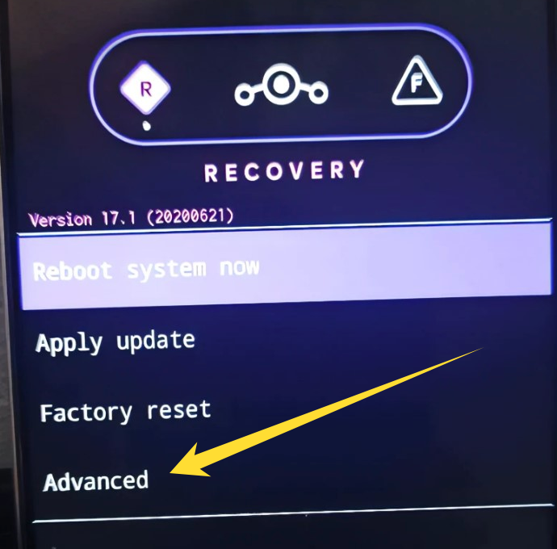

网上下载手机机型以及操作系统对应的 boot.img, 以及从手机官网下载线刷包并提取 boot.img 的方式此文章不再赘述.

本文只说通过电脑执行 adb 来提取 boot 镜像的方案. 严格来讲, 只需要你的手机能在 recovery 中启用 ADB 就可以实现.

## 在 Recovery 中启用 ADB

重启进入 recovery (方案不再赘述), 然后尝试在 recovery 中寻找 "启用 ADB" 的选项. 如果你的手机 recovery 中有这个东西, 跳过此部分.

---

大部分国内厂商手机都不会给这个功能, 如果你的手机也没有, 那么接下来我们刷入并使用 [Lineage OS](https://lineageos.org/) 提供的 recovery.

在[Lineage OS 设备列表](https://wiki.lineageos.org/devices/)中寻找你的设备, 然后只下载对应的 recovery.img 即可. 注意, 不需要下载别的.

现在, 重启到 bootloader, 然后使用 fastboot 指令刷入 recovery

```bash
fastboot flash recovery recovery.img
```

> 注意, 此操作需要你的设备已经解了 BL 锁, 否则指令无法正常执行


## 确认你现在的设备是 A 槽还是 B 槽

现如今大多数设备都区分 AB 分区, 也就是说, 诸如 boot, system 这些分区, 都有 AB 两份. 名称也像 boot_a boot_b 这样.

重启进入 bootloader, 执行以下指令:

```bash
fastboot getvar current-slot
```

你会得到下面这样的消息:

```txt
current-slot: b
Finished. Total time: 0.238s
```

现在, 我们知道当前槽位了


## 提取 boot 分区

重启进入 recovery, 并且启用 ADB.

对于 Lineage OS 的 Recovery, "Enable ADB" 的选项一般会在 "Advanced" 当中.



现在, 在你的电脑上执行 `adb shell dd` 提取镜像, 注意, **如果你是 A 槽, 那么 if 后面的 boot_b 就应该是 boot_a**

```bash
adb shell dd if=/dev/block/bootdevice/by-name/boot_b of=/sdcard/boot.img
```

如果执行成功了, 你会得到类似这样的消息:

```txt
196608+0 records in
196608+0 records out
100663296 bytes (96 M) copied, 0.096 s, 0.9 G/s
```

如果失败了, 你会得到类似这样的消息:

```txt
dd: /dev/block/bootdevice/by-name/boot: No such file or directory
0+0 records in
0+0 records out
```

---

在成功后, 我们只需要通过 `adb pull` 就可以从设备上下载镜像到电脑了.

```txt
adb pull /sdcard/boot.img
```

此指令会将 boot.img 下载到你终端的当前工作目录.

> 注意, 你必须将它通过 adb pull 下载下来, 因为 recovery 中的 /sdcard 分区是临时的, 再重启之后, 你就看不到刚刚通过 dd 弄出来的 boot.img 了


## 后续操作

如果你用它是为了使用 Magisk, APatch 这类工具进行修补, 那么下一步, 你可以通过 `adb push` 将它上传到手机中.

重启手机, 然后执行 adb 指令就可以了:

```bash
adb push boot.img /sdcard/boot.img
```